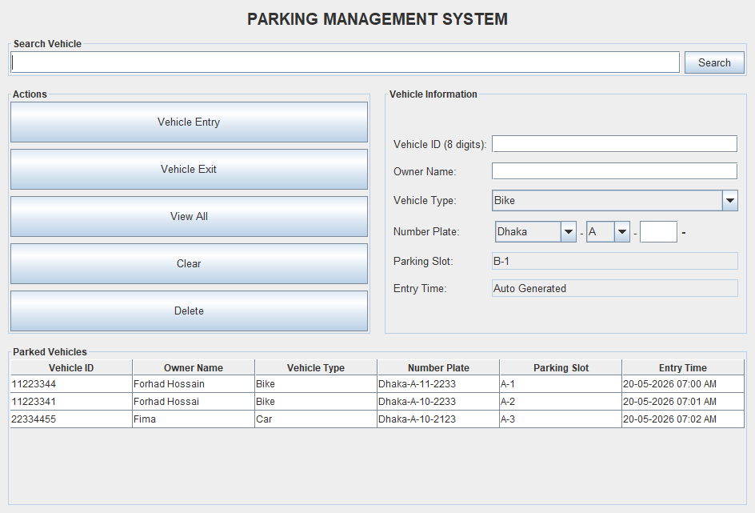

<div align="center">

# Object-Oriented Programming 1 (Java)

**Coursework from OOP1 at American International University-Bangladesh (AIUB), Spring 2025–2026**

From the first `Hello World` to a desktop **Parking Management System** built with Swing and file storage.


</div>

---

## Contents

- [About](#about)
- [Repository structure](#repository-structure)
- [Part 1: Java fundamentals](#part-1-java-fundamentals)
- [Part 2: Control flow](#part-2-control-flow)
- [Part 3: Object-oriented programming](#part-3-object-oriented-programming)
- [Part 4: Parking Management System](#part-4-parking-management-system)
- [Getting started](#getting-started)
- [What I learned](#what-i-learned)
- [Author](#author)

## About

This repository collects the programs I wrote while taking **Object-Oriented Programming 1** at AIUB. It follows the order of the course:

1. **Fundamentals**: types, operators, strings and console input.
2. **Control flow**: decisions and every kind of loop.
3. **Object-oriented programming**: classes, inheritance, abstraction, interfaces and polymorphism.
4. **Final project**: a GUI **Parking Management System** that brings it all together.

Each file is small and focused on one idea, so it can be compiled and run on its own.

## Repository structure

```text
oop1-spring-2025-2026/
├── Hello.java                   # First program
├── PrimitiveType.java           # The 8 primitive types and their sizes
├── ReferenceTypes.java          # Objects as reference types (Date)
├── TypesDifference.java         # Primitive copy vs reference copy
├── Strings.java                 # Common String methods
├── Operations.java              # Arithmetic, increment/decrement, compound assignment
├── ComparisonOperators.java     # ==, !=, <, >, <=, >=
├── LogicalOperators.java        # &&, ||, ! with a loan-eligibility example
├── ScannerIn.java               # Reading console input with Scanner
├── ProceduralProgramming.java   # Splitting logic into a static method
├── IfElseStatements.java        # if / else if / else
├── ForLoop.java                 # Counting up and down
├── ForEachLoop.java             # Indexed loop vs enhanced for-each
├── WhileLoop.java               # Counter loop and loop-until-"exit"
├── DoWhileLoop.java             # Loop that always runs at least once
├── Start.java                   # OOP: gym membership system
├── docs/
│   └── parking-gui.png          # Screenshot of the final project
└── parking-management-system/
    └── parkingmanagementsystem/
        ├── Start.java           # Entry point
        ├── entity/
        │   └── Vehicle.java     # Data model
        ├── fileio/
        │   ├── VehicleFileIO.java   # File storage, search, slot logic
        │   └── vehicles.txt         # Sample data
        └── gui/
            └── ParkingGUI.java  # Swing user interface
```

## Part 1: Java fundamentals

| File | Topic | Key ideas |
| --- | --- | --- |
| `Hello.java` | First program | `main` method, `System.out.println` |
| `PrimitiveType.java` | Primitive types | `byte`, `short`, `int`, `long`, `float`, `double`, `char`, `boolean`, their sizes and ranges |
| `ReferenceTypes.java` | Reference types | Creating objects with `new` (`java.util.Date`) |
| `TypesDifference.java` | Value vs reference | Copying a `byte` copies the value; copying a `Point` copies the reference |
| `Strings.java` | Strings | `length`, `substring`, `replace`, `toUpperCase`, `trim`, `startsWith`, `charAt`, `indexOf` |
| `Operations.java` | Arithmetic | `+ - * / %`, pre/post increment, compound assignment |
| `ComparisonOperators.java` | Comparison | Relational operators returning `boolean` |
| `LogicalOperators.java` | Logic | `&&`, `\|\|`, `!` used in a real decision (loan eligibility) |
| `ScannerIn.java` | Input | Reading a `byte` and a `String` with `Scanner` |
| `ProceduralProgramming.java` | Methods | Moving a wage calculation into a reusable static method |

## Part 2: Control flow

| File | Topic | What it shows |
| --- | --- | --- |
| `IfElseStatements.java` | Decisions | Even/odd check and positive/negative/zero with `else if` |
| `ForLoop.java` | `for` | Counting 0 → 10 and 10 → 1 |
| `ForEachLoop.java` | for-each | Index-based loop vs enhanced `for` over an array |
| `WhileLoop.java` | `while` | A counter loop, then a loop that runs until the user types `exit` |
| `DoWhileLoop.java` | `do-while` | A loop whose body always runs at least once |

## Part 3: Object-oriented programming

`Start.java` models a small **gym membership system** and uses each core OOP idea in one place:

| Concept | Where it appears |
| --- | --- |
| **Encapsulation** | `Member` keeps `memberID` and `monthlyFee` private behind getters and setters |
| **Abstraction** | `Member` is an `abstract` class with an abstract `showInfo()` |
| **Inheritance** | `PlatinumMember` and `StandardMember` extend `Member` and call `super(...)` |
| **Interfaces** | `IMemberOperation` defines `discountedFee()` and a `default` method `display()` |
| **Polymorphism** | `Gym` stores every member as a `Member[]` and calls `showInfo()` on each |
| **Constructor chaining** | Console output shows the parent constructor running before the child's |

The `Gym` class adds, removes and lists members, and works out total revenue with an 8% discount on fees above 8,000.

## Part 4: Parking Management System

A desktop app for running a small parking lot, built with **Java Swing** and plain **file I/O**.

<div align="center">
  
</div>

### Features

- **Vehicle entry** with the parking slot and entry time filled in automatically.
- **Six slots** (`A-1` to `A-3`, `B-1` to `B-3`), with the first free one assigned and a clear message when the lot is full.
- **Vehicle exit** with a summary of time parked and the total charge before confirming.
- **Search** by vehicle ID, owner name or number plate.
- **View all**, **clear form** and **delete record** (with confirmation).
- **Click a row** in the table to load that vehicle back into the form.
- **Data is saved** to `vehicles.txt`, so records survive a restart.

### Input validation

| Field | Rule | Example |
| --- | --- | --- |
| Vehicle ID | Exactly 8 digits | `20012005` |
| Owner name | Letters and single spaces only | `Forhad Hossain` |
| Number plate | Bangladesh format: District - Series - 2 digits - 4 digits | `Dhaka-LA-11-2233` |
| Duplicates | Same vehicle ID, owner or plate can't be parked twice | |

### Fees

| Vehicle | Entry fee | Hourly charge |
| --- | --- | --- |
| Bike | 30 TK | 10 TK per hour |
| Car | 40 TK | 10 TK per hour |

Time is rounded **up** to the next full hour, with a minimum of one hour.

### Design

The project is split into packages so each class has one job:

| Package | Class | Responsibility |
| --- | --- | --- |
| `entity` | `Vehicle` | Holds one vehicle's data and converts it to and from a line of text |
| `fileio` | `VehicleFileIO` | Reads and writes `vehicles.txt`, finds free slots, checks duplicates, searches |
| `gui` | `ParkingGUI` | Builds the window, validates input and shows dialogs |
| (root) | `Start` | Starts the GUI on Swing's event thread with `SwingUtilities.invokeLater` |

Records are stored one per line as comma-separated values:

```text
11223344,Forhad Hossain,Bike,Dhaka-A-11-2233,A-1,20-05-2026 07:00 AM
```

Deleting a record writes every other line to a temporary file and then replaces the original, so the data file is never left half-written.

## Getting started

### Requirements

- **JDK 8 or newer** (tested with JDK 25). Check with `java -version`.

### Run a fundamentals or OOP program

From the repository root:

```bash
javac *.java
java Hello
java Strings
java Start
```

### Run the Parking Management System

The app looks for its data file relative to the `parking-management-system` folder, so run it from there:

```bash
cd parking-management-system
javac parkingmanagementsystem/Start.java parkingmanagementsystem/entity/Vehicle.java parkingmanagementsystem/fileio/VehicleFileIO.java parkingmanagementsystem/gui/ParkingGUI.java
java parkingmanagementsystem.Start
```

The window opens with three sample vehicles already parked.

## What I learned

- How Java separates **primitive values** from **object references**, and why that matters when copying variables.
- Choosing the right **loop** and **condition** for the job, and validating user input instead of trusting it.
- Using **abstraction, inheritance, interfaces and polymorphism** to keep related classes consistent without repeating code.
- Splitting a real application into **model, storage and interface** layers.
- Building a working **Swing GUI** with layouts, tables and dialogs, and saving data safely with **file I/O**.

## Author

**Md. Forhad Hossain Mahamud**
B.Sc. in Computer Science & Engineering, American International University-Bangladesh

- Portfolio: [forhad-portfolio-sepia.vercel.app](https://forhad-portfolio-sepia.vercel.app)
- GitHub: [@ForhadHossain71](https://github.com/ForhadHossain71)
